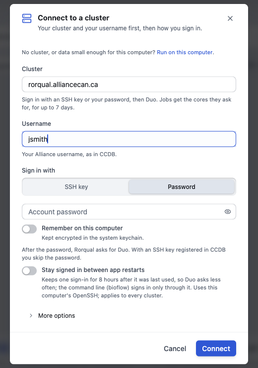
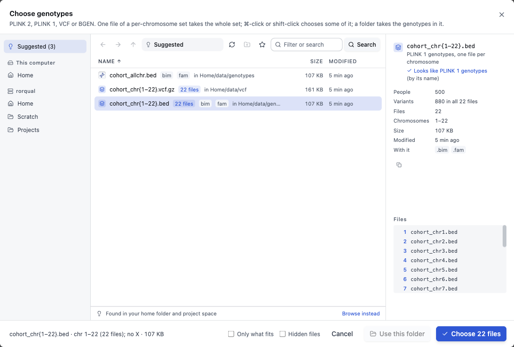
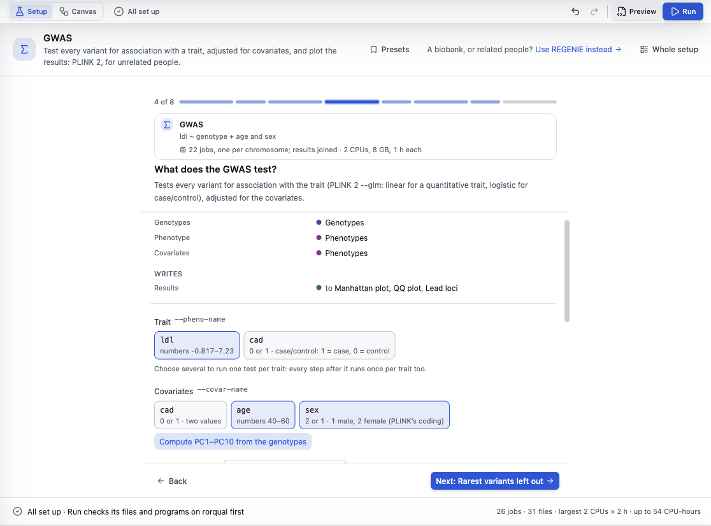
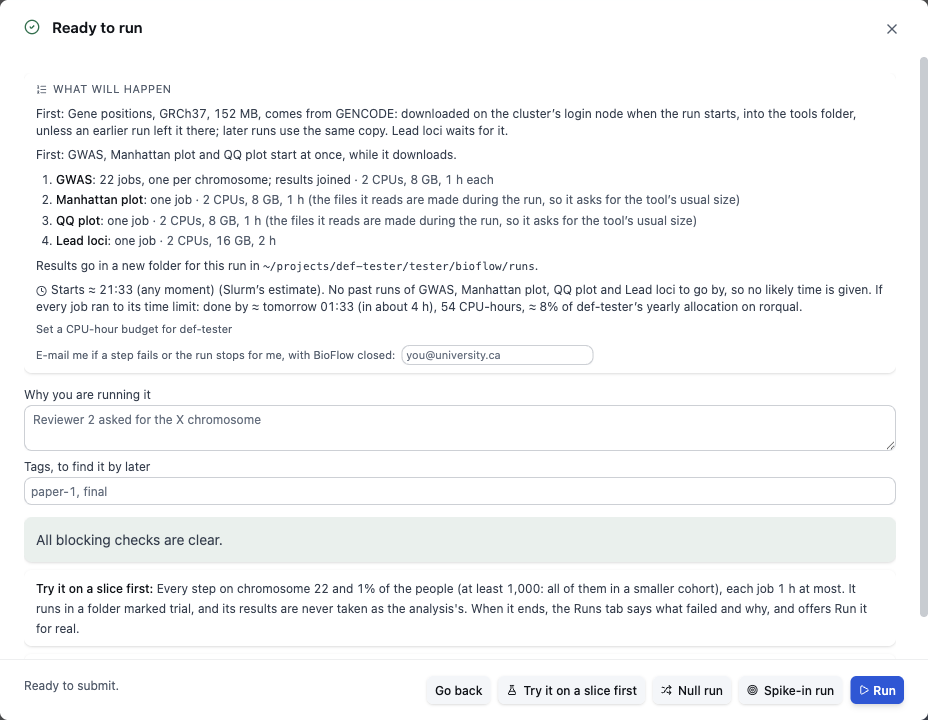
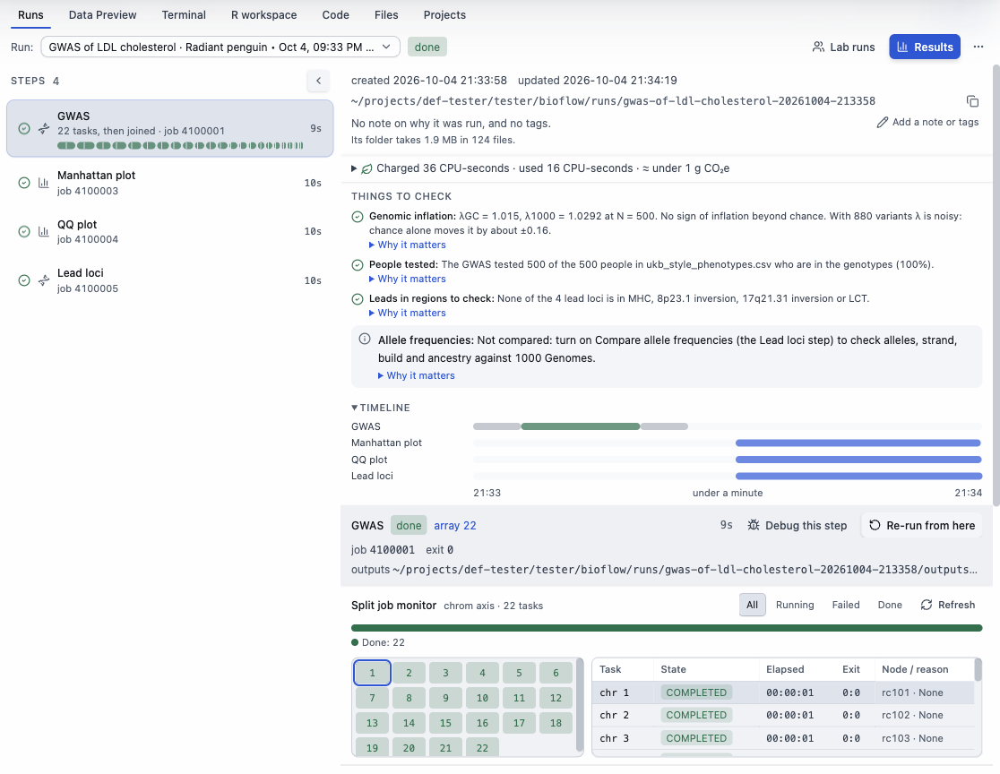
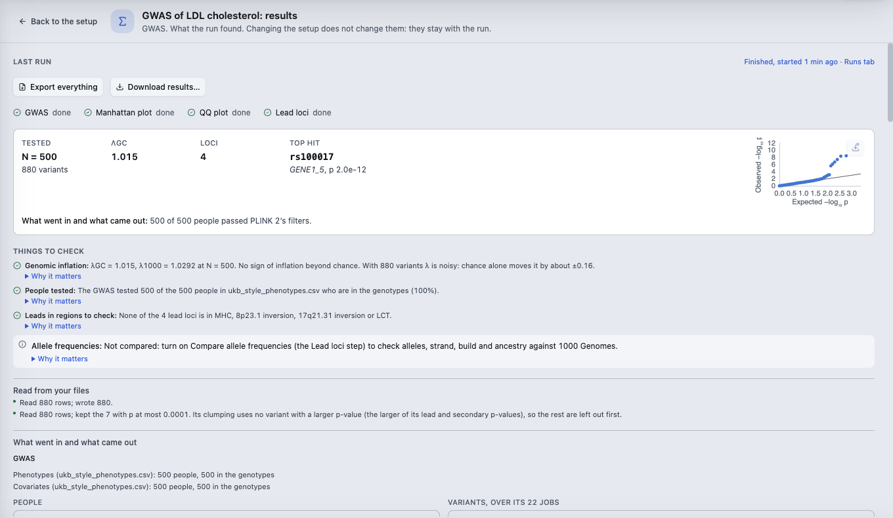
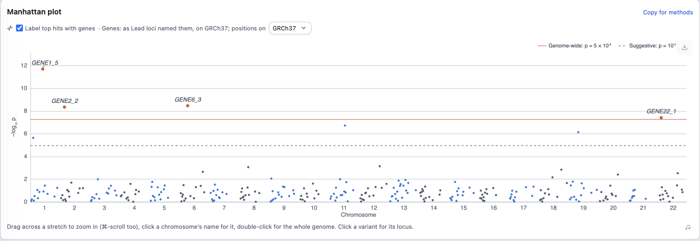
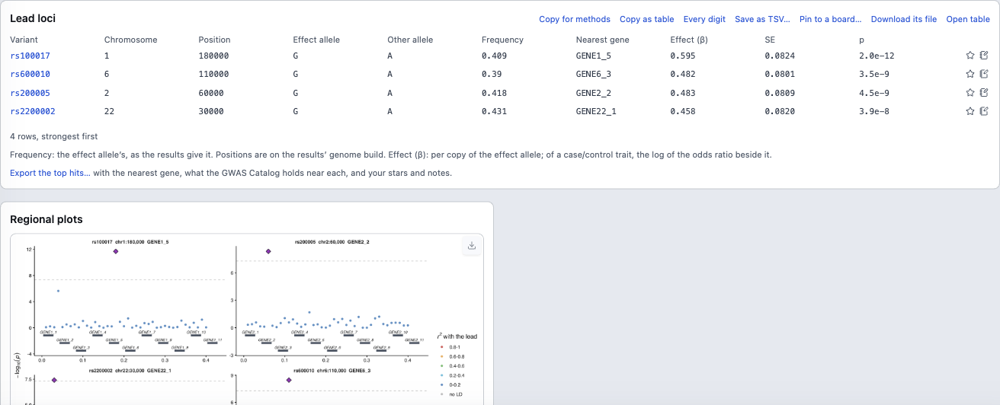

# Getting started with BioFlow Studio

This guide takes about 15 minutes. You sign in to your cluster, pick a set of genotypes and a phenotype table, run a GWAS with PLINK 2, read its results, and learn how to tell us when something goes wrong.

The screenshots come from a stand-in cluster with a simulated cohort of 500 people, so your numbers will differ.

- [Install and first launch](#install-and-first-launch)
- [Sign in to a cluster](#sign-in-to-a-cluster)
- [Pick your files](#pick-your-files)
- [Set up and run a GWAS](#set-up-and-run-a-gwas)
- [Watch it run](#watch-it-run)
- [Read the results](#read-the-results)
- [Export](#export)
- [When something goes wrong](#when-something-goes-wrong)
- [What BioFlow sends where](#what-bioflow-sends-where)

Known problems in this beta, and what to do instead, are in [KNOWN-ISSUES.md](KNOWN-ISSUES.md).

## Install and first launch

Download and open the app as the [README](README.md#download) says.

The first window asks **What do you want to do?** and lists the analyses, grouped by kind. You don't need to sign in yet. Choose an analysis, and the app asks you to sign in when it needs the cluster.

**Take the tour** (top right, or **Help ▸ Take the Tour**) shows the window's parts in a minute.

## Sign in to a cluster

Click **Connect to a cluster** in the bar at the top of the first window, or the **Not connected** menu at the top right.

1. Under **Cluster**, click **Rorqual** (or Narval, Fir, Nibi, Trillium), or type your cluster's address.
2. Under **Username**, type your Alliance username, as in CCDB.
3. Under **Sign in with**, choose **Password** or **SSH key**. With an SSH key registered in CCDB, the cluster doesn't ask for your password.
4. Click **Connect**. The dialog shows each stage: **Reach the cluster**, **Check it is the same cluster**, **Sign in**.
5. **Duo:** after the password, the cluster asks for Duo. The app shows the choices as buttons (**Send a push**, **Call me**, **Text me passcodes**) and a box to type a passcode.

The first time, the app remembers the cluster's identity (its host key). If it ever changes, the app stops and says so, with **Forget saved identity** for when your cluster's support says the change is expected.

Once you're connected, the top right shows the cluster's name in green, and the first window shows **Connected to rorqual · Slurm account def-…**. The app found your Slurm account by itself. **Slurm settings** changes it.

**Options in the dialog:**
- **Remember on this computer** keeps your password in the system keychain, encrypted.
- **Stay signed in between app restarts** keeps one sign-in for 8 hours after it was last used, so Duo asks less often. It uses this computer's OpenSSH. To end it early, open the connection menu at the top right and choose **Sign out of …**. On Windows, leave it off (see the known issues).
- **More options** sets the SSH port and the folder the file list opens in.

**What signing in does on the cluster:** it reads your Slurm account, the modules the cluster offers and the queue. It installs nothing. BioFlow writes on the cluster only when you act:
- A run writes into its own run folder. By default that is `~/projects/<your account>/<you>/bioflow/runs`; change it in **Settings ▸ Runs**.
- A program, R package or reference file that you agree to install goes into BioFlow's tools folder, `~/bioflow/tools`. R packages go into R's own library unless you choose otherwise in **Settings ▸ Programs ▸ R packages**.

**No cluster?** **Run on this computer** at the top of the dialog runs the same analyses here (Mac and Linux only). **Practice on simulated data**, in the first window's Learn group, is a GWAS and polygenic score on 1,000 simulated people, run on this computer, where you know the true answers.

## Pick your files

A GWAS needs genotypes and a phenotype table. When the setup asks for one, click **Choose genotypes** (or **Choose phenotypes**). The file picker opens.

- **Suggested** lists matching files that it found in your home and project folders. To go anywhere else, use **Home**, **Scratch** and **Projects** on the left, or type a path.
- **A folder of chromosomes:** files named by chromosome (`cohort_chr1.bed` … `cohort_chr22.bed`, or a folder per chromosome) show as one set: `cohort_chr{1–22}.bed`, **22 files**. Choose it, and each step runs once per chromosome as a Slurm array.
  - To choose only some chromosomes, ⌘-click or shift-click them (Ctrl on Windows and Linux).
  - To take everything in a folder, use **Use this folder**.
- The panel on the right shows what the app read from the file: its format, how many people and variants, and which chromosomes. Check it before you click **Choose**.
- **Formats:** PLINK 2 (`.pgen`), PLINK 1 (`.bed`), VCF and BGEN. VCF and BGEN are converted to PLINK 2 once, before any step reads them.
- **Phenotype table:** one row per person, with an ID column and the traits. Covariates can be in the same file or in another one. It can be separated by tabs, commas or spaces.
  - The ID column can be called anything: `IID`, `FID IID`, UK Biobank's `eid`, and so on. People are matched to the genotypes by their IDs.
  - Each column's values are shown with its name (for example "numbers 40–60" or "0 or 1 · case/control"), so you can see what the app read.

Your files stay on the cluster. The app reads their first rows to describe them, over your SSH connection.

## Set up and run a GWAS

1. In the first window, under **Genetic association**, click **GWAS** (PLINK 2, for unrelated people). For a biobank or related people, choose **GWAS with REGENIE** instead.
2. The setup opens as a **walkthrough**, one question at a time (**1 of 8**, …). Use **Next** and **Back**, or click the bar at the top to jump to a question.
   1. **Which genotypes?** Choose them, then pick the **Genome build**. The app says if it can tell the build from the positions.
   2. **Filter the genotypes first?** **Add quality control**, or **No thanks** if they're already cleaned.
   3. **Which phenotype file?** Choose it. **Look at the cohort** summarises it.
   4. **What does the GWAS test?** Click the trait (several traits run one test each) and the covariates. **Use age and sex** and **Compute PC1–PC10 from the genotypes** are one click each.
   5. The questions that follow are optional (rare variants, lead loci, allele frequencies). Each has a sensible default and says why.
   6. **Ready to run?** summarises the analysis. It also lists what the jobs need on the cluster (modules, programs, R packages, reference data) and whether the cluster has each one.

   

3. **Check:** the chip at the top left says what is left to do (**2 to do**, then **All set up**). The bar at the bottom names each item: click one to go to it. That bar also shows the jobs, files, the largest job's size and the most CPU-hours the run could use.
4. **Whole setup** shows every question at once. **Canvas** shows the steps as a diagram, where you can change any setting. Neither is needed for a first run.
5. Click **Run** (top right, or ⌘↵). The app checks the files, modules and programs on the cluster first.
   - If something is missing, it says what, and offers the fix where there is one, for example **Install REGENIE now** or an R package install.
   - When all is clear, **Ready to run** says what will happen: each step's jobs and their size, where the results go, Slurm's estimate of when it starts, and the most CPU-hours it can use.

   

6. Click **Run**. To test the setup cheaply first, click **Try it on a slice first**: every step runs on chromosome 22 and a small share of the people.

Jobs are submitted with `sbatch` under your account. The run goes on if you close BioFlow or your laptop sleeps, and the app picks it up when you open it again.

## Watch it run

The **Runs** tab, at the bottom of the window, shows the run you started. Click **Open as page** to give it the whole window.

- **On the left:** each step, with its Slurm job number, its state and how long it took. A step that runs per chromosome shows one mark per task.
- **On the right:** the run folder (the copy button copies its path), what the run used in CPU-hours, **Things to check** once it ends, a timeline, and the selected step's jobs. The task grid shows each chromosome's state; click one to see its job.
- **The bell** (top right) collects what happened: a run started, a step failed, a run finished. **Show the run** opens it.
- The app also shows a notification on this computer when a run finishes or fails. Turn these off in **Settings ▸ General ▸ Notifications**. **E-mail me** on the Ready to run page sends Slurm's own e-mail, which reaches you even with BioFlow closed.
- **Cancel run** stops its jobs. The **⋯** menu (**More for this run**) has **Open run folder**, **Report of what ran**, **Download results…**, **Keep this run…** and more.

## Read the results

When the run ends, click **Results** in the Runs tab. The results also stay on the setup page.

- **The summary:** how many people and variants were tested, λGC, the number of loci and the top hit, with a small QQ plot.
- **Things to check:** genomic inflation, how many people in your phenotype file were tested, leads in regions such as the MHC, and allele frequencies. Each has **Why it matters**.
- **What went in and what came out:** people and variants at each step, as the jobs counted them. **Where did a variant go?** finds a variant in each step's files.
- **Manhattan plot:** drag across a stretch to zoom in, click a chromosome's name to show it alone, and click a variant to open its locus. **Label top hits with genes** names the nearest genes.

  

- **QQ plot and genomic inflation**, with λGC and λ1000 explained.
- **Strongest associations** and **Lead loci:** the independent lead variants after clumping, each with its nearest gene, effect, SE and p-value. **Regional plots** show the strongest loci. Star a row or add a note to it.

  

- **Copy for methods** (on each part) copies a sentence for a methods section.
- **What next** offers analyses that start from these results: a polygenic score, Mendelian randomization, fine-mapping, colocalisation and more.
- **Explore in R** opens the results as data frames in the **R workspace**, with R running where the files are.

**Report of what ran**, in the Runs tab's **⋯** menu, puts the whole run on one page: what ran, the commands and scripts, what it found, and a methods draft.

## Export

On the results page:
- **Export everything** writes a zip of every figure and table, an Excel workbook, or a Word document, to a folder you choose on this computer.
- **Download results…** copies the result files (summary statistics, lead loci, plots), with the run's report and methods draft, into your BioFlow folder on this computer, or into a folder you choose.
- Each table has **Copy as table**, **Save as TSV…** and **Download its file**. Each plot has a download button at its top right.

Results hold summary statistics, never your phenotype rows. A file of individual people (scores, for example) is only copied here when you ask for it.

## When something goes wrong

**A step failed.** The Runs tab marks it failed, and the bell says so. Select the step to see why. The app reads Slurm's record of the job and the end of its log, and says what happened in plain words. For example:
- the job ran out of memory or time;
- a file or column wasn't found;
- PLINK refused a flag.

Where there is one change that would let it run, a button makes it and runs the step again, for example **Memory 8 → 16 GB, and re-run**. **Take me there** opens the setting it names, and changes nothing until you do. **Re-run from here** runs that step and the steps after it again; the steps before it are not run again. **Debug this step** opens a shell on a compute node, in the Terminal tab, to try the step's commands by hand.

**Tell us.** Choose **Help ▸ Report a Problem…**:
1. It asks what you did and what happened.
2. It writes a plain-text report: the app's version, your computer's system and the app's recent log. Paths, host names and user names are taken out, and it holds no data from your files. Open it and read it before you send it.
3. **Open on GitHub** opens a new issue on this repository, with your description filled in, and shows the report file. Drag the file into the issue, then submit it.

You need a GitHub account to file an issue. **Issues here are public:** never paste data, file contents or anything about people into one. For a question that isn't for a public page, ask the person who invited you.

If the app itself won't start or freezes, file an issue by hand from [the issues page](https://github.com/nkkoran/bioflow-releases/issues/new/choose). Give the version (**Settings ▸ About**, or **BioFlow Studio ▸ About BioFlow Studio** on a Mac) and your operating system.

## What BioFlow sends where

**Your data stays on your cluster.** BioFlow signs in with your own account and runs your jobs there. Your genotypes, phenotypes and results are read where they are, over your SSH connection, and nothing is uploaded to us. BioFlow has no telemetry, no analytics and no crash reporting: crash reports stay on this computer. It has no server of its own.

What does leave, and when:

**Every time the app opens**
- **The update check:** the app reads the list of releases on this repository (`github.com/nkkoran/bioflow-releases`). GitHub sees your IP address and a random number that the updater keeps, to spread updates out. When there is a new version, the app downloads it from the same place.

**When you use a feature that looks something up** (from this computer, and only what's listed)
- **Ensembl** (`rest.ensembl.org`), for the genes near a peak: the chromosome and the stretch of positions.
- **The GWAS Catalog** (EBI):
  - **How many loci to expect**, and searching for a published GWAS: the trait's words.
  - **Seen before?**: your lead variants' positions, and the trait's words.
  - **A published study you link**: its accession.
  - **A live analysis, if you make one**: the trait's words, again when you sign in or a run ends.
- **OpenGWAS** (`api.opengwas.io`, with your own token, set in **Settings ▸ Data sources**):
  - a dataset's ID;
  - **Compare with a published GWAS**: your lead variants' positions;
  - **MR clumping on OpenGWAS, when you choose it**: the candidate instruments' variant IDs and p-values.
- **The PGS Catalog**: the ID of a score you choose.
- **Open Targets**: a gene or protein name, when you ask a drug-target question about the results.
- **Published GWAS lists** (FinnGen, Pan-UKB, the eQTL Catalogue): their public lists are downloaded and searched on this computer, so nothing you type is sent.
- **Public files you link** (a published GWAS on an approved site, such as EBI, Zenodo or FinnGen's bucket): the app reads the file's size and its first rows to describe it.
- **The genome viewer and genome builds**: the reference genome and liftover chains come from UCSC (`hgdownload.soe.ucsc.edu`).
- **Running on this computer**: PLINK 2 and DuckDB are downloaded from their own sites when you install them, and checked against their checksums.

**From the cluster's login node, when a run or an install needs it**
- **A public file a step reads, and reference data:** downloaded with `curl` from where it's published, for example GENCODE gene positions or 1000 Genomes frequencies. The cluster's compute nodes have no internet, so this happens before the jobs start. **Ready to run** lists each download.
- **Programs you agree to install:**
  - PLINK 1.9 from its own site;
  - REGENIE and DuckDB from their GitHub releases;
  - LDSC and others with `git clone`;
  - Python packages from the Alliance's wheelhouse, else PyPI.
- **R packages you agree to install:** from CRAN, R-universe, Bioconductor or GitHub.
- **Containers**, only if you choose **Settings ▸ Clusters ▸ Run tools from ▸ Pinned containers**: pulled from their registry (quay.io by default).
- **A message when a run ends**, only if you set a webhook in Settings: the pipeline's name, the cluster and how many jobs finished.

**Links you click** (documentation, CCDB, a study's page) open in your web browser.

**Bug reports** are written to a file on this computer. Nothing is sent until you open the GitHub issue and attach the file yourself.
