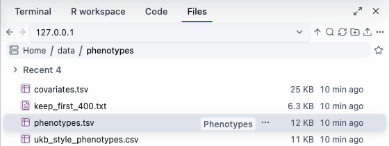
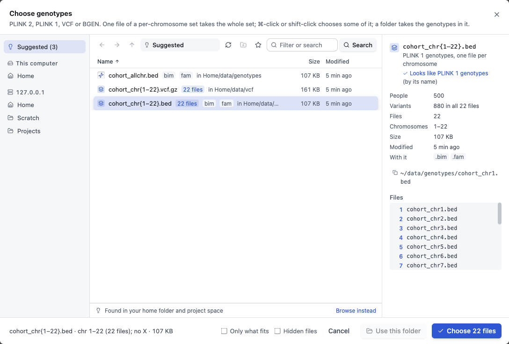
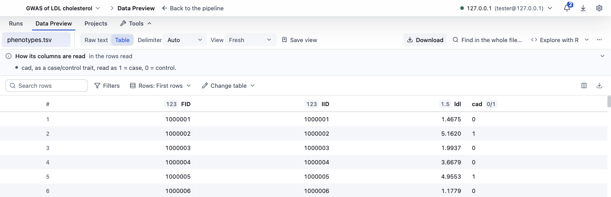

# Your files

[The guide](../GUIDE.md) · Previous: [Sign in to a cluster](sign-in.md) · Next: [Set up an analysis](set-up.md)

Your files stay where they are. BioFlow reads them over your SSH connection, and the jobs read them on the cluster.

## The file browser

There are two ways to browse:
- **The sidebar**, at the left edge: click the folder icon (**Show files**) to open it, **Hide files** to fold it again.
- **Files**, in the tools drawer at the right: **⌘6** (Ctrl+6 on Windows and Linux), **View ▸ Show or hide Files**, or **Tools ▸ Files** in the bar at the bottom. With both open, **Tab** goes between them.

In either:
- **The place** at the top: a cluster you are signed in to, **This computer**, or **BioFlow folder on this computer** (where downloads go).
- **The path:** click its parts to go up, or press **/** (or ⌘L) to type a path; **Tab** completes it.
- **Double-click** a folder to open it, a file to see it in Data Preview (below).
- **Right-click** a file for more: **Open Preview**, **Quick Look**, **Get Info**, **Copy Path**, **Use as Input**, **Download to your BioFlow folder**, **Download to…**, **Join these…** (two tables or more), **Open Terminal here**, **Rename**, **Move to…**, **Delete** and others.
- **Upload:** drag files from your computer's own file manager onto a folder on the cluster. BioFlow asks first, then checks each file's sha256 at both ends. **Upload** in the browser's bar does the same from a file chooser.
- **Delete** on the cluster moves things to BioFlow's own trash there (**Trash…** in the browser's **⋯** menu restores them); on this computer it uses the system's Trash.
- The **⋯** menu also has **Folder sizes**, **Storage and smart folders…**, **Bookmark folder**, and the views (a tree, or details).

## Choosing files for an analysis

When a setup needs a file, its card has **Choose…**. The file picker opens.

- **Suggested** lists matching files: what you chose before, and what your bookmarked places, your home folder, your project space and the folders beside this analysis's other files hold. **Browse instead** goes to the folders; **Home**, **Scratch** and **Projects** on the left, or type a path.
- **The panel on the right** shows what BioFlow read from the file: its kind ("Looks like PLINK 1 genotypes"), how many people and variants, which chromosomes, and the files that go with it. Check it before you click **Choose**.
- **Only what fits** hides the files this step does not read; **Hidden files** shows the ones whose names start with a dot.
- You can also drag files from the file browser onto a setup's card.

### Genotypes

- **Formats:** PLINK 2 (`.pgen`), PLINK 1 (`.bed`), VCF and BGEN. VCF and BGEN are converted to PLINK 2 once, before any step reads them.
- **A set of chromosomes:** files named by chromosome (`cohort_chr1.bed` … `cohort_chr22.bed`) show as one row, `cohort_chr{1–22}.bed` with **22 files**. Choosing it (**Choose 22 files**) takes the whole set, and each step runs once per chromosome, as a Slurm array. One file of a set takes the whole set.
- **A folder:** **Use this folder** takes the genotypes in it.

### A phenotype table

One row per person: an ID column and the traits, and covariates too if they are in the same file. Tab, comma or space separated. BioFlow finds the ID column by its name: `FID` and `IID` (PLINK's), `eid` (UK Biobank's), `sample_id`, `participant_id` and others; failing that, the first column. People are matched to the genotypes by their IDs, whatever the ID column is called.

When the setup asks for the trait and covariates, each column shows what BioFlow read in it, such as "numbers -0.817–7.23" or "0 or 1 · case/control: 1 = case, 0 = control", so you can see it was read right.

## Data Preview

Data Preview shows a file's rows. Open it by double-clicking a file, by **Open Preview** in its menu, or by dragging a file onto it. It is a tab at the bottom of the window (**⌘2**, or **View ▸ Show or hide Data Preview**); **Open as page** gives it the whole window, and the bar at the top takes you back.

- **One tab per file.** **Raw text** or **Table**; **Delimiter** (Auto finds it from the first lines).
- **Columns:** each header shows its kind (`123` whole numbers, `1.5` numbers, `0/1`, `abc` text). Click a header to sort; its chart button counts its values, or draws a boxplot or a scatter. The **Columns** sidebar (⌘J) finds, hides and orders columns, with each one's share of missing values.
- **Filters** keeps the rows that match your rules; **Search rows** keeps rows that contain some text. **How its columns are read** says how BioFlow reads a column a job will use, such as a case/control trait.
- **View** and **Save view** keep a set of filters, columns and order to come back to.
- **Change table** adds a column, renames columns or joins another table, over every row, into a new file: the file itself stays as it is.
- **Find in the whole file…** looks for an ID or a value in every row.
- **Explore with R** opens the table in the [R workspace](r-and-code.md).
- **Download** copies the file to your BioFlow folder on this computer.

**Big files:** a large file shows its first rows, and says how many it has. To sort, filter, count or plot every row, BioFlow uses its data engine (DuckDB) where the file is: **Install the data engine** puts it in your tools folder, once. Nothing leaves the cluster to do it.

**Other formats:** Parquet and Excel files open like any table (an Excel file asks which sheet), and **Convert to TSV** writes a tab-separated copy beside it. PDFs and images show as they are.

Next: [Set up an analysis](set-up.md).
