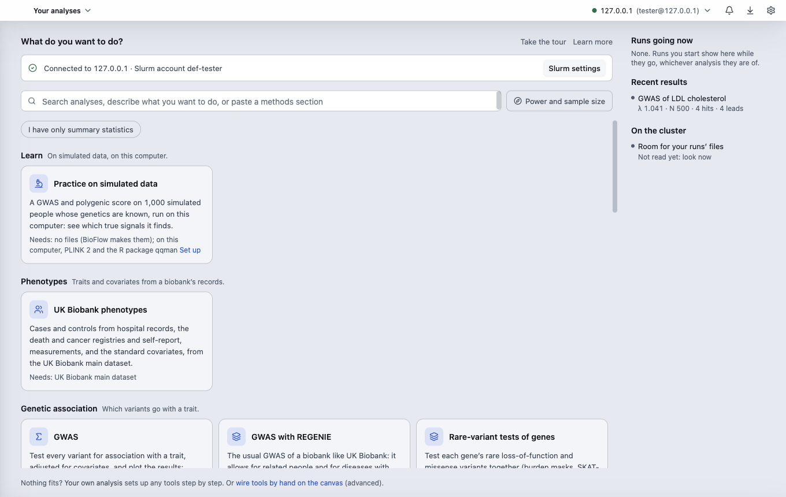

# Install and first launch

[The guide](../GUIDE.md) · Next: [Sign in to a cluster](sign-in.md)

## Download and open it

Open the [latest release](https://github.com/nkkoran/bioflow-releases/releases) and download the file for your computer:

| Your computer | File | Then |
| --- | --- | --- |
| Mac (Apple silicon or Intel) | the `.dmg` | Open it and drag BioFlow Studio to Applications. |
| Windows 10 or 11 (64-bit) | the `Setup` `.exe` | Run it; it installs for your account only. |
| Linux (x86-64) | the `.AppImage`, or the `.deb` | Make the AppImage executable (`chmod +x`) and run it, or install the `.deb`. |

The `.zip`, `.yml` and `.blockmap` files are what the app's updater reads: you don't need them.

**The first time it opens:**
- **Mac:** the app is signed and notarized by Apple, so it opens normally.
- **Windows:** the app is not signed yet. SmartScreen says "Windows protected your PC": click **More info**, then **Run anyway**. You do this once per version.
- **Linux:** no extra step.

## The first window

The first window asks **What do you want to do?**:
- **The strip under it** says where analyses run. Before you sign in it says you sign in when you run, or now from **Not connected** at the top right. Once you are signed in it says **Connected to … · Slurm account …**.
- **The search box** finds an analysis by its name, or sets one up from what you type in your own words, or from a methods section you paste. [Set up an analysis](set-up.md) says more.
- **The gallery** lists the analyses, grouped by what they do: **Learn**, **Phenotypes**, **Genetic association**, **Polygenic scores**, **Mendelian randomization**, **Proteomics**, **Quality control and ancestry**, **Sequencing**, **Variant files**, **Your own** and **Other starting points**. Each card says what it does and what it **Needs**. A group shows its first three cards; **N more:** shows the rest.
- **Power and sample size**, before a study: how many people it needs to find an effect, and who is in your cohort.
- **I have only summary statistics** keeps only the analyses that start from published or earlier results.
- **On the right** (on a wide window): **Runs going now**, **Recent results** and, once you are signed in, **On the cluster**: how much room your runs' folder has.

You don't need to sign in to look around. Choose an analysis, and the app asks you to sign in when it needs the cluster.

**First-use tips:** a few tips point out the parts of each screen the first time you see it. **Done** goes to the next one, **No more tips** ends them. **Take the tour**, beside the question, or **Help ▸ Take the tour**, shows them again.

**Practice on simulated data**, in the **Learn** group, is a GWAS and a polygenic score on 1,000 simulated people whose true signals are known. It runs on this computer, so it needs no cluster and no files of yours. The card says what it needs on this computer (PLINK 2 and an R package); when something is missing, **Set up** offers to install it, then **Start practice** (or **Start anyway**) sets the analysis up. It is not offered on Windows.

## Updates

The app checks for a new version each time it opens; **Check for updates** (in the BioFlow Studio menu on a Mac, the Help menu elsewhere) checks now.
- **Mac, Windows and the Linux AppImage** download a new version by themselves and install it when you next quit and reopen the app.
- **The Linux `.deb`:** download the new `.deb` from the releases page and install it.

The version you have is in **Settings ▸ About** (or **BioFlow Studio ▸ About BioFlow Studio** on a Mac).

## Where to go from here

- **Help ▸ Getting started** opens this guide, and **Help ▸ Known issues** the [known issues](../KNOWN-ISSUES.md).
- **Help ▸ Keyboard shortcuts** (⌘/) lists every key, and **Help ▸ Command palette…** (⌘K, or Ctrl+K on Windows and Linux) finds any command, analysis, setting or result by typing.
- **Learn more**, in the places you meet first, opens the page of this guide about that place.

Next: [Sign in to a cluster](sign-in.md).
