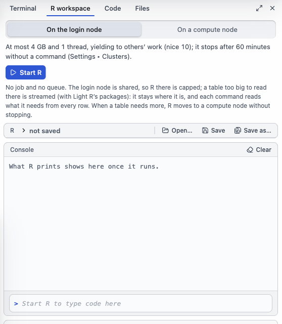

# R, the terminal and code

[The guide](../GUIDE.md) · Previous: [When something goes wrong](when-it-fails.md) · Next: [Settings and look](settings.md)

## The tools drawer

Four tools open in a drawer at the right of the window, beside what you are looking at (over it, on a narrow window):

| Tool | Key | View menu |
| --- | --- | --- |
| **Terminal** | ⌘3 | **Show or hide Terminal** |
| **R workspace** | ⌘4 | **Show or hide R workspace** |
| **Code** | ⌘5 | **Show or hide Code** |
| **Files** | ⌘6 | **Show or hide Files** |

On Windows and Linux the keys are Ctrl+3 to Ctrl+6. **Tools**, in the bar at the bottom of the window, lists them too. The same key closes the tool; the drawer's tabs switch between them, its edge drags to make it wider, and the button at its top right gives a tool the whole window. A closed tool keeps where it was. [Your files](files.md) covers Files.

## Terminal

A shell on the cluster's login node, through the sign-in you already have. **New terminal** opens another tab.

- **Start a compute session…** asks for CPUs, memory, hours (and GPUs) and opens a shell on a compute node with `salloc`, showing the command and the wait first. Your account is charged until the session ends, when the tab closes or its time is up: type `exit` when you are done.
- **Saved commands** keeps commands you use often, per cluster: **Type** puts one at the prompt, **Run** runs it. **Typed here lately** lets you keep one you just typed.
- **Open Terminal here**, in the file browser's menu, and **Open a terminal in the run folder**, in a run's **⋯** menu, open one in that folder.

## R workspace

R in the app: a script, a console, the environment and plots, with R running on the cluster where your files are.

- **Where R runs:** **On the login node** starts at once, within the login node's limits (the drawer says them: memory, threads, and how long it may sit idle); **On a compute node** starts a job of the size you ask for. R on the login node can move to a compute node without stopping, when a table needs more. On this computer, R runs here.
- **Start R**, then write in the **Script** (**Run cell**, **Run all**; **Open…**, **Save**) or type in the **Console**. **Environment** lists your objects; **Plots** keeps what you draw.
- **Big tables:** on the login node, a big table is streamed rather than loaded (Light R), so each command reads only what it needs from every row.
- **From elsewhere:** **Explore with R** in Data Preview, and **Explore in R ▸ Open in R workspace** on a run's results, open the table or the results here as data frames.

R packages: BioFlow uses R's own library on the cluster, as your R module and your `~/.Renviron` set it, unless you choose another in **Settings ▸ Programs**. When a step needs a package that is missing, **Run** offers to install it from the login node.

## Code

**Code** holds the code you open in tabs: a step's command (from its **What it runs**), your own step's script, or the R workspace's script. **Open in a tab**, above any of them, opens it here. An edit is the step's own: what you change in a tab is what the step runs. A dot marks a tab with changes not saved yet.

**What it runs** shows a step's command as the job will run it: the PLINK 2 call with its flags, or the R. You can edit a composed call such as a GWAS's: a change a setting can hold becomes that setting; one it can't is kept only if you choose **Keep it as my own command**. PLINK 2's flags are offered as you type, and a flag BioFlow does not know is marked, though it runs as typed.

Next: [Settings and look](settings.md).
