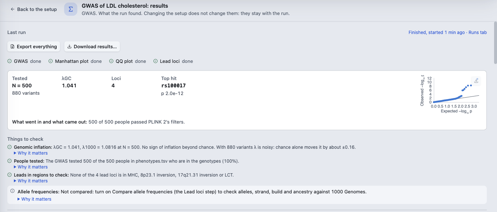
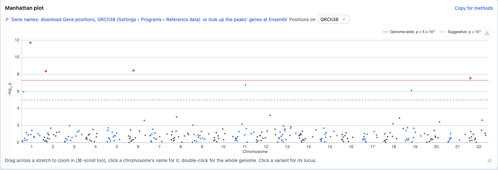
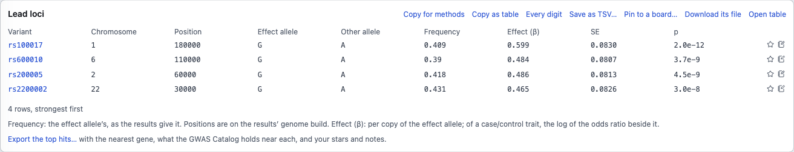

# Results

[The guide](../GUIDE.md) · Previous: [Run and watch](run.md) · Next: [When something goes wrong](when-it-fails.md)

When a run ends, click **See results**: in the Runs tab, or at the top of the analysis's setup. The results stay with the run: changing the setup afterwards does not change them. **Back to the setup** goes back.

## The summary

- **Export everything** and **Download results…** are at the top (see [Exports](#exports)).
- **The results in brief:** how many people and variants were **Tested**, **λGC**, the number of **Loci** and the **Top hit**, with a small QQ plot. Under it, **What went in and what came out** in one line.
- **Things to check:** genomic inflation, how many people in your phenotype file were tested, leads in regions such as the MHC, allele frequencies, and more where they apply. Each has **Why it matters**, and says what it is based on. The same list is in the Runs tab.
- **Read from your files**, and **What went in and what came out**: people and variants at each step, as the jobs counted them.
- **Where did a variant go?** finds a variant (`rs1234` or `1:12345`) in each step's files.

## Plots and tables

- **Manhattan plot:** drag across a stretch to zoom in (or ⌘-scroll), click a chromosome's name to show it alone, double-click for the whole genome, and click a variant to open its locus. **Label top hits with genes** names each peak's nearest genes. That needs gene positions: the plot offers **download Gene positions** (**Settings ▸ Programs ▸ Reference data**), or to look the peaks' genes up at Ensembl.
- **QQ plot and genomic inflation:** the plot, with λGC and λ1000 explained in words beside it.
- **Strongest associations:** the genome-wide hits, then the suggestive ones, each with its effect, its 95% interval and its p-value, and a note on how sure each is.
- **Lead loci:** the independent lead variants, after clumping. **Export the top hits…** writes them with the nearest gene, what the GWAS Catalog holds near each, and your stars and notes.
- **Regional plots** of the strongest loci.

**A locus:** click a variant for its page: a regional plot, the genes near it, and whether it was seen before. **★** stars a row and the note button writes a note on it, kept with the run, for you only.

Further down:
- **Ask these results:** a question in words ("Which hits are near PCSK9?", "Top 10 by p"), answered from the run's tables on the cluster. Only a drug-target question ("Is LPA a known drug target?") sends anything: the gene's name, to Open Targets.
- **Seen before?:** whether the lead variants are near loci the GWAS Catalog has for this trait.
- **What next:** analyses that start from these results: a polygenic score, Mendelian randomization, fine-mapping, colocalisation and more.
- **Explore in R:** **Open in R workspace** loads the results as data frames, with R running where the files are.

**Copy for methods**, on each part, copies that step's sentence for a methods section, with what to cite. Check it, and put it in your own words.

## The run's report

**Report of what ran**, in the run's **⋯** menu in the Runs tab, puts the run on one page: **Summary**, **Methods** (a draft from the run's own record and files), **Share** (save the report as a page or slides), **Before it ran**, **Files and data**, **Results**, **Steps**, and **Code**: each step's calls, then its whole script.

## Exports

- **Export everything:** every figure and table on the page as **A zip of every figure and table…** (each figure as SVG and a 300 dpi PNG, with the methods draft), **An Excel workbook…** or **A Word document…**, saved where you choose on this computer.
- **Download results…** copies the result files (summary statistics, lead loci, plots), with the run's report and methods draft, into your BioFlow folder on this computer. It says the size first.
- **Each table:** **Copy as table** (pastes into Word or Excel), **Every digit**, **Save as TSV…**, **Download its file** and **Open table** (in Data Preview).
- **Each plot:** the download button at its top right: **Save as SVG…**, **Save as PDF…**, **Save as PNG, 300 dpi…**, and **For a journal…**, redrawn at a journal's width and text size.

Results hold summary statistics, never your phenotype rows. A file of individual people (scores, for example) is only copied to this computer when you ask for it.

## The results library and comparing runs

**Results library**, in the command palette (⌘K), lists what every finished run found, newest first, kept on this computer. Type a trait, a gene, a protein or a variant to find the runs that found it. **See results** opens one; picking a run fades the runs it did not come from or lead to. A run marked **Stale** read a file that has a newer version since; **Frozen** marks a run you kept.

**Compare with…**, in a run's **⋯** menu (or tick two runs in the Runs tab's list and click **Compare…**), shows what changed between two runs and what each found.

Next: [When something goes wrong](when-it-fails.md).
