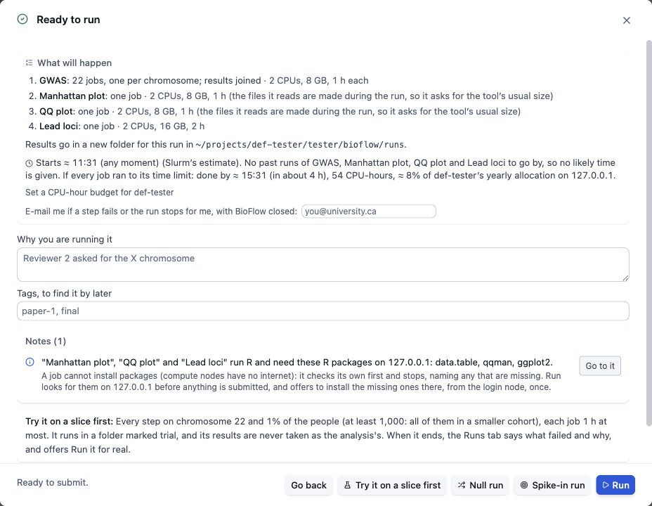
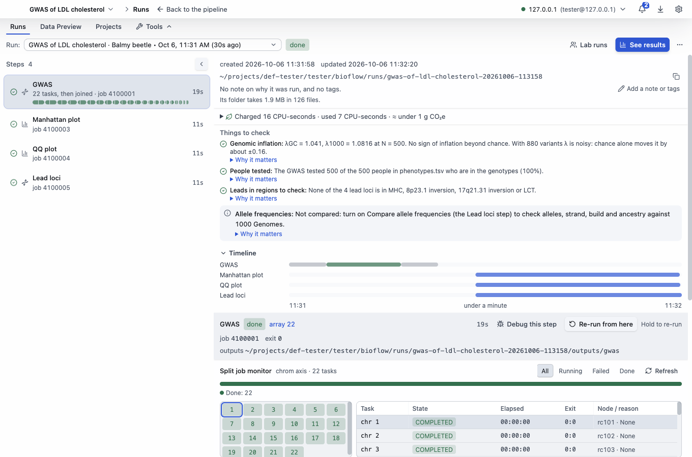

# Run and watch

[The guide](../GUIDE.md) · Previous: [Set up an analysis](set-up.md) · Next: [Results](results.md)

## Run

Click **Run** (top right, or ⌘↵; Ctrl+Enter on Windows and Linux). BioFlow first checks, on the cluster, that the files are there and readable, and that the modules, programs and R packages the jobs load are there.
- If something is missing, it says what, and offers the fix where there is one, for example **Install REGENIE now**, or an R package install from the login node (compute nodes have no internet). An install goes on if you close the window, and a message says when it is done.
- If something must change first, it says what, with **Go to the first problem**.

Then **Ready to run** says what will happen, before anything is submitted:

- **What will happen:** each step's jobs and their size, anything downloaded first, and where the results go: a new folder for this run.
- **Slurm's estimate** of when it starts, and, if every job ran to its time limit, when it would be done, how many CPU-hours that is, and what share of your account's yearly allocation.
- **Set a CPU-hour budget** for your account: kept for every run on this cluster (**Settings ▸ Clusters**), and the review then says how much of it this run can use.
- **E-mail me if a step fails or the run stops for me, with BioFlow closed:** Slurm's own e-mail, which reaches you even with BioFlow closed (kept for every run; **Settings ▸ General ▸ Notifications**).
- **Why you are running it** and **Tags**, to find the run again later.
- **Notes** and warnings, each with **Go to it**.

Then click **Run**. Its jobs are submitted with `sbatch`, under your account.

**Try it on a slice first** runs every step on chromosome 22 (or the first chromosome every set has) and 1% of the people (at least 1,000, or everyone in a smaller cohort), each job one hour at most. It runs in a folder marked trial, and its results are never taken as the analysis's. When it ends, the Runs tab says what failed and why, and offers **Run it for real**. Use it before a big run.

**Null run** and **Spike-in run** (for a GWAS) check the analysis itself: the GWAS again with each person's phenotype and covariates moved onto another person's genotypes (its false positives and λ), or with a known effect added at one variant (whether it finds it at your sample size).

**Run again**, on an analysis that has run before and spends cluster hours, asks you to hold the button for a second (**Hold to run again**). Letting go early runs nothing. A first run is one click.

## The Runs tab

The **Runs** tab, at the bottom of the window, shows the run you started (**⌘1**, or **View ▸ Show or hide Runs**). **Open as page** gives it the whole window; the bar at the top takes you back.

- **Run:** the run's name, with a nickname (such as "Balmy beetle") and when it started. Click it for every run: each has a ring with a part per step (filled when done, red when failed), and its state in words ("Step 3 of 4 running", "Done: 4 of 4", "Failed at step 2 of 4"). You can search them, or tick two and **Compare…** them.
- **Steps**, on the left: each step's state, its Slurm job number ("22 tasks, then joined · job 4100001" for one run per chromosome, with a mark per task) and how long it took.
- **On the right:** the run's folder on the cluster (the copy button copies its path), a note or tags (**Add a note or tags**), the CPU time it was charged, **Things to check** once it ends, a timeline, and the selected step: its job, exit code, outputs, and per-chromosome tasks (click one to see its job).
- **The buttons:** while it runs, **Cancel run** (steps that already finished keep their files); once done, **See results**; failed, **Re-run from here** or **Show what to do** (see [When something goes wrong](when-it-fails.md)).
- **The ⋯ menu** (**More for this run**): **Refresh**, **Open run folder**, **Open a terminal in the run folder**, **Open a copy of the pipeline as it ran**, **Compare with…**, **Report of what ran**, **Download results…**, and, once it ends, **Tidy in-between files…**, **Pack into one archive…**, **Keep this run…** and **Remove from the run history…** (which leaves its folder as it is).

## The bell and notifications

**The bell**, at the top right, collects what happened: a run started, finished, failed or waits for you, a step failed, a download or install ended. Each has **Show the run** where there is one, and **Clear all** empties it.

When the window is not in front, the app also shows a notification on this computer when a run finishes, fails or stops for you. **Settings ▸ General ▸ Notifications** turns each kind off, or on a sound.

## Runs that go on with BioFlow closed

Once submitted, the jobs are Slurm's: the run goes on if you close BioFlow or your laptop sleeps. When you open BioFlow again and sign in, it reads the run's jobs from Slurm and picks up where the run got to; it also looks again when its window comes back to the front, and **Refresh** in the run's **⋯** menu looks now. Until you sign in to that cluster, the run says **Not currently watching this run**.

A run that stops for you (after a step set to wait for your look, or a test between steps that failed) waits until you open BioFlow and click **Continue**; Slurm's e-mail, if you asked for it, tells you when.

Next: [Results](results.md).
