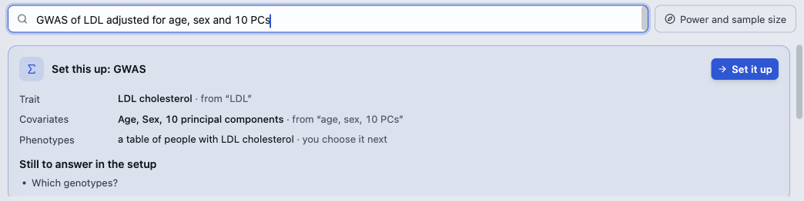
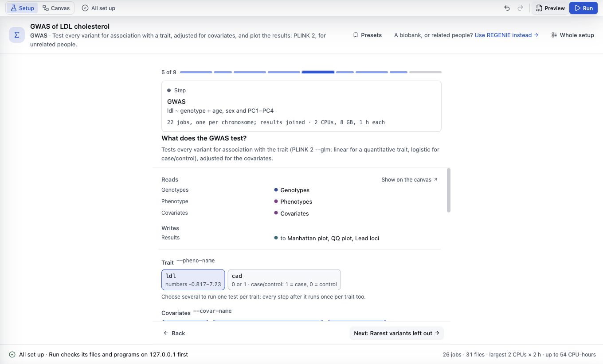

# Set up an analysis

[The guide](../GUIDE.md) · Previous: [Your files](files.md) · Next: [Run and watch](run.md)

An analysis is a setup: a few questions (which files, which trait, which covariates), with a sensible default for the rest. BioFlow turns your answers into steps, and each step into Slurm jobs.

## Choose one, or say what you want

In the first window (**What do you want to do?**), click an analysis in the gallery, for example **GWAS** under **Genetic association** (PLINK 2, for unrelated people). For a biobank or related people, choose **GWAS with REGENIE**. A GWAS's setup also offers **Use REGENIE instead** at the top.

Or type what you want into the search box, in your own words:

BioFlow reads it with fixed rules (no AI model, and nothing is sent anywhere) and shows **Set this up: …**: each answer it took from your words ("from …"), what it suggests, what is **Still to answer in the setup**, and anything it did not understand. Nothing changes until you click **Set it up**. You can also paste a methods section from a paper: it then says where the setup would differ from the paper.

To start another analysis later, use the menu under the analysis's name at the top left ▸ **New analysis** (⌘N).

## The walkthrough

The setup can go one card at a time (**Step by step**) or show every card at once (**Whole setup**), with the card you are on beside it; the button at the top right switches. Either way:
- **The bar of dots** shows where you are (**5 of 9**); click a dot to jump. **Back** and **Next: …** go one card at a time; the last card is the review.
- **An input card** (Genotypes, Phenotypes) has **Choose…**. See [Your files](files.md).
- **An offer** ("Filter the genotypes first?") adds a step, such as **Add quality control**, or **No thanks**. It can be added or taken off later.
- **A step's card** asks only what has no default. For a GWAS: the **Trait** (choose several to run one test each: every step after it runs once per trait too), the **Covariates** (**Use age, sex and PC1–PC4** and **Compute PC1–PC10 from the genotypes** are one click each), and **People**. Its first line says what will run ("ldl ~ genotype + age, sex and PC1–PC4") and how ("22 jobs, one per chromosome; results joined · 2 CPUs, 8 GB, 1 h each").
- **More settings** holds the rest, each with its default and why it is that. A setting marked * is needed before it can run.
- **What it runs**, under a step's settings, shows the command the job will run (the PLINK call, or the R). You can edit it there; **Open in a tab** opens it in the Code tool. The [R, the terminal and code](r-and-code.md) page says more.
- **Show on the canvas** opens the step on the **Canvas**, which shows the analysis's steps as a diagram with every setting of each. You don't need it for a first run.

**Presets** keeps your answers under a name, to use them again on another setup.

## What is left to fix

The bar at the bottom of the setup says what is left, in words: **3 to fix**, then each place, such as **Phenotypes** or **GWAS**. Click one to go to it. The same count is at the top left, beside **Setup** and **Canvas**.

When nothing is left it says **All set up · Run checks its files and programs on … first**, then **Ready to run** once those checks have passed. Warnings show as a count too ("1 warning"): they don't stop a run.

The right end of the bar says the size of the run: "26 jobs · 31 files · largest 2 CPUs × 2 h · up to 54 CPU-hours". "Up to" counts every job to its time limit; most finish well before.

**Preview**, at the top right, shows the scripts each job will run, without submitting anything.

Your setup is saved as you go. The analyses you opened last come first in the command palette (⌘K).

Next: [Run and watch](run.md).
