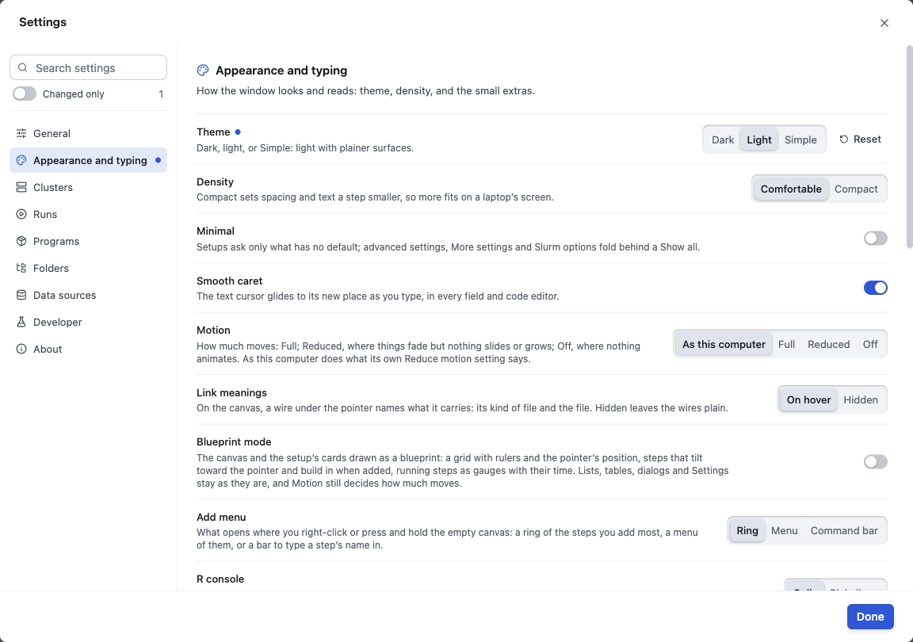

# Settings and look

[The guide](../GUIDE.md) · Previous: [R, the terminal and code](r-and-code.md) · Next: [What BioFlow sends where](sends-where.md)

**Settings** is the gear at the top right (⌘, on a Mac). **Search settings** finds one by its words, and **Changed only** shows the ones you changed. Each setting says what it does; a changed one has a dot and **Reset**. **Done** closes it.

## The sections

- **General:** your name, as your lab reads it; autosave; and **Notifications**: **Notify when a run finishes**, **… fails**, **… stops for me**, **Play notification sound**, **Email me at** (Slurm's own e-mail), and **Post to a webhook when a run ends**.
- **Appearance and typing:** below.
- **Clusters:** a card for the cluster you are signed in to, with its **Analysis folder** (where its runs go), its Slurm account and **Run tools from** (**The cluster's modules**, or **Pinned containers**); and for every cluster, **Stay signed in between app restarts** and a warning when a login node allows too little CPU time.
- **Runs:** job sizes (**Partition memory cap**, and whether a job the cluster made fail runs again once), the checks before a run, and the run's folder: **Run folder template** (how each run's folder is named) and its subfolders.
- **Programs:** the modules the jobs load on the cluster, what BioFlow installs (REGENIE, PLINK 1.9, DuckDB, LDSC and others), the R packages' library, **Reference data** (gene positions, 1000 Genomes frequencies and others, downloaded once into your tools folder), and **This computer**: what runs need here.
- **Folders:** every folder BioFlow uses, on the cluster and on this computer, each with a button to show it: the analysis and runs folders, the **Tools folder**, downloads, **Logs** and more.
- **Data sources:** where published data comes from, and the sign-ins it needs: your OpenGWAS token, and the approved sites.
- **Developer:** locked; for BioFlow's developers.
- **About:** the version, and where the settings file is.

## Appearance

- **Theme:** **Dark** (the default), **Light**, or **Simple** (light with plainer surfaces).
- **Density:** **Comfortable**, or **Compact**, which sets spacing and text a step smaller so more fits on a laptop's screen.
- **Minimal:** setups ask only what has no default; advanced settings, **More settings** and Slurm options fold behind **Show all**.
- **Motion:** **As this computer** (follows your system's Reduce motion setting), **Full**, **Reduced** (things fade, but nothing slides or grows) or **Off** (nothing animates). BioFlow moves only to tell you something: a step that ends, a count that changes.
- **Blueprint mode:** the canvas and the setup's cards drawn as a blueprint: a grid with rulers, steps that tilt toward the pointer, running steps as gauges with their time. Lists, tables, dialogs and Settings stay as they are, and Motion still decides how much moves. Off by default.
- **Link meanings:** on the canvas, a wire under the pointer names what it carries.
- **Add menu:** what opens when you right-click, or press and hold, the empty canvas: a **Ring** of the steps you add most, a **Menu**, or a **Command bar**.
- The rest is for code: the R console's look, code colours, the pipe BioFlow writes in R (`%>%` or `|>`), brackets, indent guides, and warnings about R mistakes as you type. Also: **Columns per page in Data Preview**, **UK Biobank names** and **Easter eggs**.

## Keys

**Help ▸ Keyboard shortcuts** (⌘/) lists every key, by where it works. The ones to know (Ctrl instead of ⌘ on Windows and Linux):

| Key | Does |
| --- | --- |
| ⌘K | The command palette: any command, analysis, setting, file or result, by typing |
| ⌘↵ | **Run…** |
| ⌘N, ⌘O, ⌘S | **New analysis**, **Open analysis…**, **Save** |
| ⌘1, ⌘2 | **Runs**, **Data Preview** at the bottom |
| ⌘3 to ⌘6 | **Terminal**, **R workspace**, **Code**, **Files** in the tools drawer |
| ⌘, | **Settings…** |

A key a text box or the terminal uses stays theirs while you type there.

Next: [What BioFlow sends where](sends-where.md).
