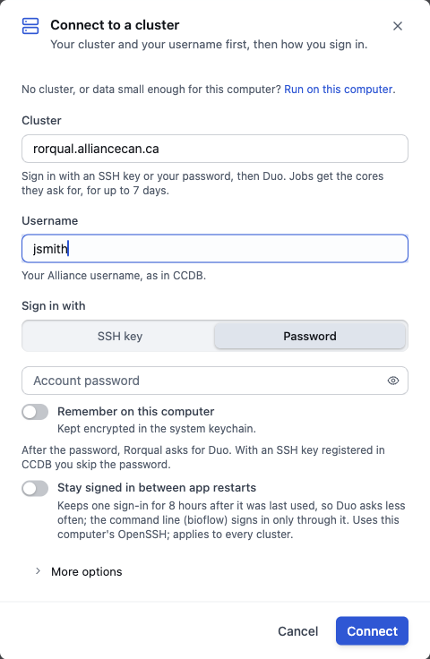

# Sign in to a cluster

[The guide](../GUIDE.md) · Previous: [Install and first launch](install.md) · Next: [Your files](files.md)

BioFlow runs your analyses on a Slurm cluster you sign in to with your own account: Rorqual first, or another Alliance cluster, or any cluster you reach by SSH.

## Connect

Click **Not connected** at the top right. If an analysis needs the cluster, its **Run** button says **Connect to run** and opens the same dialog.

1. **Cluster:** click **Rorqual**, **Narval**, **Fir**, **Nibi** or **Trillium**, or type your cluster's address. The line under it says how that cluster signs you in.
2. **Username:** your Alliance username, as in CCDB.
3. **Sign in with:**
   - **Password**: type your account password. **Remember on this computer** keeps it in the system keychain, encrypted.
   - **SSH key**: choose a key on this computer, or **Create a key**. With a key registered in CCDB (My Account ▸ SSH Keys), the cluster skips the password. Trillium takes keys only.
4. Click **Connect**. The dialog shows each stage: **Reach the cluster**, **Check it is the same cluster**, **Sign in**, **Second step (Duo)**, **Connected**.
5. **Duo:** after the password, an Alliance cluster asks for Duo. The dialog shows the choices as buttons (**Send a push**, **Call me**, **Text me passcodes**), and a box to type a passcode (**Use passcode**).

**More options** sets the cluster's name in BioFlow, its SSH **Port** (22 unless your lab says otherwise), and the **Start folder** where the file list opens.

If signing in fails, the dialog says why, with **Change settings** and **Try again**; **Details** shows what the cluster answered.

**The cluster's identity:** the first time, BioFlow keeps the cluster's host key. If it ever changes, BioFlow refuses to connect and sends neither your password nor your Duo code. When your cluster's support says the change is expected, **Forget saved identity** forgets the old key and signs in again.

The next time, the dialog lists the clusters you used, each with **Connect**, and **Another cluster** to add one.

## Stay signed in between app restarts

**Stay signed in between app restarts** keeps one sign-in for 8 hours after it was last used (**Hours kept**, under **More options**, changes that), so Duo asks less often. It also lets the `bioflow` command line use the cluster. It uses this computer's OpenSSH and applies to every cluster; it is off until you turn it on, here or in **Settings ▸ Clusters**.

It is not offered on Windows, whose OpenSSH cannot keep a sign-in (see the [known issues](../KNOWN-ISSUES.md)).

## Once you are connected

- The top right shows the cluster's name and `you@cluster` with a green dot. Its menu has **Slurm settings**, **Cluster doctor** (what BioFlow found on the cluster, and what is missing), **Connection Settings** and **Disconnect**. With **Stay signed in** on, it also has **Sign out of …**, which ends the kept sign-in, so the next connection asks for Duo again; **Disconnect** keeps it.
- The first window says **Connected to … · Slurm account def-…**. BioFlow found your Slurm account by itself: if your login has only one, a message says so, with **Change it**. With several, it asks you to choose. **Slurm settings** changes it.

## What signing in does on the cluster

Signing in reads, and writes nothing:
- the modules the cluster offers, and its Slurm version;
- the login node's limits (how much a command may use there);
- your home folder;
- your Slurm account, when none is chosen yet.

BioFlow writes on the cluster only when you act:
- **A run** writes into its own folder: `runs/<analysis>-<date and time>` in your analysis folder. On an Alliance cluster, the analysis folder is `~/projects/<your account>/<you>/bioflow` when your project space can be written to, else your scratch or home folder. **Settings ▸ Clusters** (**Analysis folder**) and **Settings ▸ Runs** (**Run folder template**) change them.
- **A program, R package or reference file that you agree to install** goes into BioFlow's tools folder, `~/bioflow/tools` (**Settings ▸ Folders**). R packages go into R's own library unless you choose otherwise in **Settings ▸ Programs**.

## No cluster?

**Run on this computer**, at the top of the dialog, runs the same analyses on this computer (Mac and Linux only: each step is a bash script). It suits data small enough for a laptop, and the **Practice on simulated data** card.

Next: [Your files](files.md).
